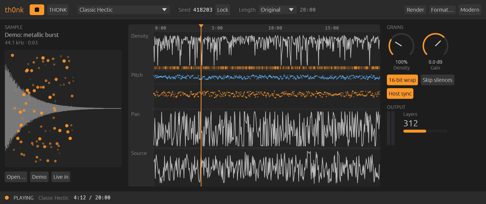
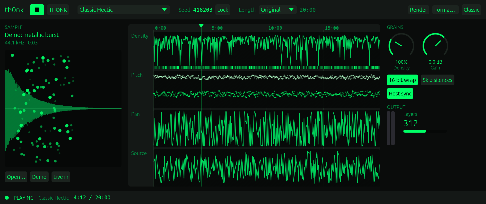

# th0nk3000

```
  _   _     ___         _     _____  ___   ___   ___  
 | |_| |__ / _ \ _ _   | |__ |__ / |/ _ \ / _ \ / _ \ 
 |  _| '  \ (_) | ' \  | / /  |_ \ | (_) | (_) | (_) |
  \__|_||_|\___/|_||_| |_\_\ |___/_|\___/ \___/ \___/ 
                                                       
  COLLIDER • REVERSE-ENGINEERED FROM AUDIO EASE 1996 • macOS / CLAP / VST3 / AU
```

> *"Luck is not the hand of God. Luck is the way the wind swirls, and the dust settles, eons after God has passed by."*  
> — Kurt Vonnegut (*The Sirens of Titan*), quoted in the original thOnk_0+2 manual.

**th0nk3000** is a modern recreation of **thOnk_0+2** (1996–1999), the cult Mac OS
freeware sound generator by **Arjen van der Schoot** / Audio Ease, with an interface
by **=cw4t7abs** (antiorp). It was rebuilt from the original PowerPC executable:
the granular engine and all of its scores are a translation of the binary, not an
imitation of its sound.

It runs as a **standalone app**, as an **audio plugin (AU v2, VST3, CLAP)** and as
a **command-line renderer**, on macOS.



---

## Contents

- [What thOnk was](#what-thonk-was)
- [Quick start](#quick-start)
- [The interface](#the-interface)
- [Using it in a DAW](#using-it-in-a-daw)
- [Length: Original, Stretch, Cut](#length-original-stretch-cut)
- [Rendering to disk](#rendering-to-disk)
- [The scores](#the-scores)
- [How faithful is it?](#how-faithful-is-it)
- [Command-line renderer](#command-line-renderer)
- [Install](#install)
- [Build from source](#build-from-source)
- [Testing and validation](#testing-and-validation)
- [Repository layout](#repository-layout)
- [License and credits](#license-and-credits)

---

## What thOnk was

thOnk had no knobs. You gave it a 16-bit mono AIFF and picked a *score*. Then you
hit **Thonk** and left the Mac writing a 20-minute granular "mini-composition" to
disk, often for hours: *"…where you have NO CONTROL WHATSOEVER over the process."*

Every score scatters random breakpoints for seven grain parameters across 20
minutes. Those parameters are density, grain length, attack, decay, gain, read
position and stereo balance, plus a four-voice statistical transposer. The
values are interpolated between breakpoints, so the parameters *"fight for the
attention of the listener"*. When many grains overlap, thOnk does not clip: its
16-bit adds **wrap around** (*"Compared to which clipping is a picnic"*).

th0nk3000 plays that same process in real time and also renders it to disk, as
the original did.

## Quick start

1. Open **Th0nk.app** (or insert the plugin on a track). It opens **stopped and
   silent**.
2. Click **Open…** and choose a WAV or AIFF file, or click **Demo** for the
   built-in sound.
   - Short sounds (5–15 s) with lots happening give the most varied results.
3. Choose a score in the top bar (for example *Classic Hectic*).
4. Press **▶** to listen. Press **THONK** to draw a new composition with a new
   seed and play it.
5. Heard something you like? Press **Lock** next to the seed. The project will
   recall that exact composition.
6. Press **Render** to write it to a file.

## The interface

| Area | What it shows / does |
|---|---|
| **Top bar** | ▶ / ■ transport · **THONK** (new composition) · score menu · seed and **Lock** · length mode and length · **Render** and **Format…** · theme switch (Modern / Classic) |
| **SAMPLE** | The loaded sound's waveform, with live dots for the grains being read right now. Horizontal position = where in the file the grain reads; vertical position = stereo balance. **Open…**, **Demo** and **Live in** (granulate the track/microphone input) |
| **SCORE** | The composition drawn as automation-style lanes: **Density** (grains/s, log scale, with a heat strip of estimated overlapping layers), **Pitch** (the four transposer voices; opacity = probability), **Pan** and **Source** (read position). The orange line is the playhead; click or drag to move it |
| **GRAINS / OUTPUT** | **Density** and **Gain** knobs · **16-bit wrap** · **Skip silences** · **Host sync** · output meters · number of overlapping grains |
| **Status line** | Transport state, the score actually playing (useful with *ztochazt!k*), position / length, render progress with **Cancel** |

The **Classic** theme brings back the original's phosphor-green look:



### Controls in detail

- **Density** (20–300 %) multiplies the score's grain rate. 100 % is the original.
- **Gain** (−24 to +12 dB) is applied after the wrap, so it changes the level,
  not the amount of wrapping. To get more wrap, feed it a hotter sound.
- **16-bit wrap**: on (default) is the original's overflow. Off sums grains in
  floating point with a soft clipper.
- **Skip silences** is not in the original. thOnk's grain clock can jump many
  seconds ahead in a density valley, which leaves long silences (up to several
  minutes in *Classic Flowing*). With this on, the clock never jumps more than
  0.5 s and empty stretches are skipped.
- **Host sync** follows the DAW transport (see below). In the standalone app, the
  **space bar** toggles its transport, so Space starts and stops playback.
- **Seed**: 0 = a new random composition on every Thonk (the original seeded
  from the clock). Any other value recalls one composition. The seed is a normal
  parameter, so it is saved with the project and can be automated.

## Using it in a DAW

- **Host sync on** (default): th0nk plays while the DAW plays, and composition time
  follows the project timeline: **bar 1 = 0:00**. Starting playback at 2:00
  starts the composition at 2:00. Jumps and loops are followed. Since grain
  randomness is reseeded from the position, **a bounce from the same position
  with the same seed is identical every time**.
- **Host sync off**: use th0nk's own ▶ / ■ and THONK. When a composition ends, a
  new one follows automatically.
- **The sound is saved with the project.** Sounds up to ~8 M samples (about 3 min
  at 48 kHz) are embedded in the project. Longer ones are stored by path and
  reloaded from disk.
- Every control is a regular automatable parameter: score, wrap, live input,
  density, seed, gain, length mode, length, skip silences, host sync.

## Length: Original, Stretch, Cut

| Mode | Behaviour |
|---|---|
| **Original** (default) | The score's own length: 20 min, or 1 / 5 min for the stretches. The ending is the original's: the file runs until the last grain has sounded, so it can be a little longer, or contain long silences |
| **Stretch** | The whole score is time-scaled into the length you set (10 s – 60 min). Every breakpoint moves, so the full arc fits. Grain density and grain length do not change, only how fast the parameters evolve. A 2-minute *Hectic* is ten times more restless; a 60-minute *Flowing* becomes very slow |
| **Cut** | The score plays at its own pace and stops at the length you set, like quitting the original early (*"unless prematurely stopped"*). It cannot be longer than the score |

In Stretch and Cut, the composition ends **exactly** at the chosen length, with a
30 ms fade.

## Rendering to disk

**Render** asks for a file name and renders the current settings (score, seed,
length, density, wrap, gain, skip silences) in the background. Progress and a
**Cancel** button appear in the status line; a cancelled render leaves no partial
file.

- Files are written at the **sound's own sample rate**, as the original did.
- **Format…**: WAV or AIFF (by file extension), **16-bit**, **24-bit** or
  **32-bit float** (AIFC for float AIFF), and optional **normalisation** to
  −0.3 dBFS.
  - Normalisation renders twice with the same seed: one pass to measure the
    peak, one to write.
- **16-bit, wrap on, 0 dB, no normalisation is bit-exact**: the file holds the
  same 16-bit sums the original would have written.
- With Seed = 0, the status line reports which seed was used, so the render can
  be reproduced.

## The scores

| Score | Length | Character |
|---|---|---|
| Classic Flowing | 20 min | the original Thonk, sparse: slowly evolving narrative |
| Classic Hectic | 20 min | the original Thonk, dense: fast events, good for clipping FX |
| Pentathon | 20 min | two-voice Brownian pentatonic counterpoint (23-step table) |
| Shepard | 20 min | circular pitch that keeps going down, and slowing down |
| Dis | 20 min | dark, 3–4 octaves down, every parameter moving |
| Octaves Stretch 1 / 5 min | 1 / 5 min | the sound stretched, octaves (−24, 0, +12) fading in and out |
| Plain Stretch 1 / 5 min | 1 / 5 min | the sound stretched, wide stereo, no transposition |
| Flash | 20 min | Hectic with 4× the breakpoints: *"likes its breakfast hot and dense"* |
| Slack | 20 min | Hectic with 40 breakpoints and a higher low voice |
| ztochazt!k = akadem!k wank | — | one of the above, at random |

## How faithful is it?

All of the synthesis was recovered from the binary. It was decompiled with Ghidra
and then checked instruction by instruction with a PowerPC disassembler wherever
the decompiler lost information. The full write-up, with addresses and
constants, is in **[`reverse_engineering/README.md`](reverse_engineering/README.md)**.

- **Scheduler** (`BreakPointsToSoundFile`): density is evaluated every 10 ms, and
  each grain advances a separate grain clock by `1/density`.
- **Grain renderer** (`GetGrain`, `ShapeGrain2`, `GrainToDisk`):
  - linear-interpolated resampling truncated to 16 bits;
  - 1000-point cosine attack/decay tables;
  - constant-power pan;
  - source reads clamped to the end of the file.
- **The wrap** (`AIFFSndAddStereo`): grains are summed in 32 bits and cast to 16
  on output. Addition modulo 2¹⁶ is associative, so this is bit-identical to
  the original's wrap on every add.
- **Every score constant**, including the transposer weights the decompiler
  dropped, plus the QuickDraw `Random()` generator.

What th0nk3000 changes on purpose is listed in section 9 of the reverse-engineering
document. In short: real-time playback, seeds, length modes, host sync, skip
silences, clean mode, live input, modern file formats. The defaults are the
original behaviour.

## Command-line renderer

```bash
thonk-render input.aif output.wav --score 1 --seed 1995
thonk-render input.wav out.aif --score 0 --length 2:00 --mode stretch --format 24 --normalize
```

| Option | Meaning |
|---|---|
| `--score N` | score number 0–11 (run without arguments for the list) |
| `--seed N` | fixed seed (default: random, printed at the end) |
| `--length SECS` | length in seconds or `m:ss` (implies `--mode stretch`) |
| `--mode stretch\|cut` | how `--length` is applied |
| `--skip-silence` | cap density-valley silences |
| `--clean` | no 16-bit wrap |
| `--density PCT` / `--gain DB` | as in the plugin |
| `--format 16\|24\|32f` | sample format |
| `--normalize` | peak-normalise to −0.3 dBFS |

A dense 20-minute score renders at about 110–260× real time on Apple Silicon.

## Install

Download from the [Releases](https://github.com/nagualcode/th0nk3000/releases) page.

- **`thonk-<version>-macos.pkg`**: installer; pick the formats you want.
- **`thonk-<version>-macos-arm64.zip`**: copy by hand:
  - `AU/Th0nk.component` → `~/Library/Audio/Plug-Ins/Components/`
  - `VST3/Th0nk.vst3` → `~/Library/Audio/Plug-Ins/VST3/`
  - `CLAP/Th0nk.clap` → `~/Library/Audio/Plug-Ins/CLAP/`
  - `Standalone/Th0nk.app` → `/Applications/`
  - `CLI/thonk-render` → anywhere on your `PATH`

Release 0.4.0 is built for **Apple Silicon**; Intel Macs can build from source.
The binaries are ad-hoc signed, not notarised. If macOS blocks one, right-click →
Open, or run `xattr -dr com.apple.quarantine <file>`. To make Logic pick up a new
version of the AU, run `killall -9 AudioComponentRegistrar` and reopen Logic.

## Build from source

Requirements: macOS 12+, Rust 1.85+, and for bundles/installers
[`cargo-truce`](https://github.com/truce-audio/truce).

```bash
git clone https://github.com/nagualcode/th0nk3000.git
cd th0nk3000

cargo test --release                        # tests
cargo run --release --bin thonk-standalone  # standalone app
cargo build --release --bin thonk-render    # command-line renderer

# plugins into ~/Library/Audio/Plug-Ins
cargo install --git https://github.com/truce-audio/truce cargo-truce
cargo truce install --clap --vst3 --au2 --user

# installers (add --universal for arm64 + x86_64)
cargo truce package --host-only --no-notarize --formats clap,vst3,au2,standalone
```

## Testing and validation

- `cargo test --release` runs 23 tests:
  - the decoded score structure (point counts, value ranges, transposer
    weights);
  - the Mac OS random generator;
  - the envelope tables and the wrap equivalence;
  - deterministic seeking, exact Stretch length, normalisation and cancel;
  - persistence of the embedded sound;
  - starting silent and following the host transport.
- `cargo test --release --lib rt_budget -- --ignored --nocapture` measures
  real-time block times. At 48 kHz with 128-frame blocks: ~0.8 % CPU per
  instance on average, and no block above half its budget.
- `cargo test --release --lib readme_screenshots -- --ignored` regenerates the
  screenshots in `docs/`.
- **CI** (`.github/workflows/ci.yml`, macOS) runs the tests, installs the
  plugins and validates them:
  - AU v2 with Apple's `auval`;
  - VST3 with Tracktion's `pluginval`;
  - CLAP with `clap-validator`.

  The three CLAP *state-reproducibility* tests are excluded because truce's own
  example plugins fail them the same way (truce v6.3.0).

## Repository layout

```
th0nk3000/
├── src/
│   ├── lib.rs              # plugin glue: parameters → engine, host sync, status
│   ├── engine.rs           # scheduler, whole-grain renderer, 16-bit wrap, transport, offline render
│   ├── score.rs            # the 11 scores, breakpoint lists, length modes, QuickDraw RNG
│   ├── params.rs           # parameters, persisted settings, lock-free status
│   ├── source_slot.rs      # the sound, saved with the project
│   ├── aiff.rs             # WAV/AIFF loading; 16/24/32f WAV/AIFF/AIFC writer
│   ├── ui.rs               # the editor (Modern and Classic themes)
│   ├── main.rs             # standalone app
│   └── bin/thonk_render.rs # command-line renderer
├── docs/                   # screenshots
├── reverse_engineering/
│   ├── README.md           # how the binary was taken apart
│   ├── thOnk_0+2.c         # Ghidra decompilation
│   ├── disasm_ppc.py       # PowerPC disassembler with TOC annotation
│   ├── unpack_data_sec.py / unpacked_data_sec.bin
│   ├── pefloader.java / sectionheader.java
│   ├── thOnk_0+2 ReadMe:Manual.txt
│   └── original_binaries/
└── .github/workflows/ci.yml
```

## License and credits

- Modern implementation: **MIT License** © 2026 nagualcode / Jardim Sonoro.
- Original thOnk concept and algorithms: © 1996–1999 **Arjen van der Schoot**
  (Audio Ease), with early help from Peter Bakker.
- Original visual design: **=cw4t7abs** (antiorp).
- Audio plugin framework: [Truce](https://github.com/truce-audio/truce).
