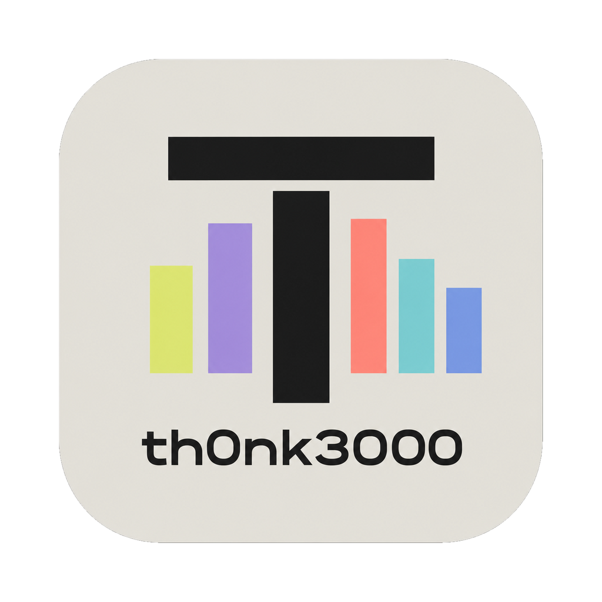

# Th0nk 0.4.2 — Jardim Sonoro (macOS, Linux e Windows)

### 🐧 🪟 Linux e Windows
A partir desta versão cada release é construído pelo GitHub Actions para as três plataformas. O motor, a interface e os scores são os mesmos da 0.4.1 — o que mudou é onde o Th0nk roda.

- **Linux (x86_64)**: CLAP, VST3, **LV2**, app standalone e a CLI `thonk-render`.
- **Windows (x64)**: CLAP, VST3, app standalone e a CLI `thonk-render`.
- **macOS (Apple Silicon)**: AU v2, VST3, CLAP, app standalone e a CLI — como antes.

AU existe só no macOS e LV2 só no Linux; os outros formatos estão em todas as plataformas.

### 📦 Instalação

**macOS (Apple Silicon / arm64)**
- **`thonk-0.4.2-macos.pkg`**: instalador.
- **`thonk-0.4.2-macos-arm64.zip`**: cópia manual (AU, VST3, CLAP, Standalone, CLI).

Macs Intel compilam a partir do código-fonte. Os binários têm assinatura ad-hoc e não são notarizados; se o macOS bloquear, use `xattr -dr com.apple.quarantine <arquivo>`.

**Linux (x86_64)**
- **`thonk-0.4.2-linux-x86_64.tar.gz`**: descompacte e rode `./install.sh`.
- **`thonk-0.4.2-linux-x86_64.zip`**: cópia manual para `~/.clap`, `~/.vst3`, `~/.lv2`.

Precisa de ALSA ou JACK e de X11/OpenGL em tempo de execução.

**Windows (x64)**
- **`thonk-0.4.2-windows.exe`**: instalador.
- **`thonk-0.4.2-windows-x64.zip`**: cópia manual para as pastas CLAP/VST3 do usuário.

O instalador não é assinado, então o SmartScreen pede "Mais informações → Executar assim mesmo" na primeira vez.
